# Clustering používateľov kreditných kariet

Segmentácia používateľov kreditných kariet pomocou algoritmov **K-Means**, **DBSCAN** a (bonus)
**aglomeratívneho hierarchického clusteringu**. Cieľom je nájsť skupiny používateľov s podobným
správaním, charakterizovať ich a pomenovať (napr. „heavy spenders“, „rich savers“).

## Dataset

`data/CC_GENERAL.csv` obsahuje 8 950 používateľov a 18 atribútov popisujúcich používanie kreditnej
karty (zostatok, nákupy, výbery hotovosti, platby, kreditný limit, …). Popis atribútov je
v `data/dataset-vysvetlivky.xlsx`.

## Štruktúra projektu

```
├── data/                  # dataset a vysvetlivky
├── figures/               # vygenerované grafy
├── src/
│   ├── config.py          # cesty, konštanty, parametre a názvy clusterov
│   ├── data.py            # načítanie dát a prieskumná analýza
│   ├── preprocessing.py   # výber atribútov, transformácia, škálovanie
│   ├── kmeans.py          # K-Means a voľba K
│   ├── profiling.py       # profily, heatmapy a PCA grafy clusterov
│   ├── dbscan.py          # DBSCAN, voľba Eps (lakeť), citlivosť na Eps
│   └── hierarchical.py    # hierarchický clustering (centroid, Ward)
├── main.py                # vstupný bod
└── requirements.txt
```

## Spustenie

```bash
python -m venv .venv
source .venv/bin/activate        # Windows: .venv\Scripts\activate
pip install -r requirements.txt
python main.py
```

Grafy sa uložia do priečinka `figures/`, profily clusterov sa vypíšu do terminálu.

## Postup

### 1. Prieskum dát

- 8 950 používateľov, 18 atribútov; `CUST_ID` je iba identifikátor a pre clustering sa nepoužije.
- Chýbajúce hodnoty: `MINIMUM_PAYMENTS` (313×), `CREDIT_LIMIT` (1×).
- Peňažné atribúty sú silne pravostranne zošikmené (napr. `PURCHASES`: medián ~361, maximum ~49 000).
  Keďže algoritmy používajú Euklidovskú vzdialenosť, je nutná transformácia a škálovanie.
- `CASH_ADVANCE_FREQUENCY` má maximum 1,5, hoci ide o frekvenciu v rozsahu 0–1, čo je chyba v dátach.


### 2. Výber atribútov a predspracovanie

Pre clustering bolo ponechaných 10 atribútov:

| Atribút | Význam |
|---|---|
| `BALANCE` | zostatok na účte (výška dlhu) |
| `PURCHASES` | celková suma nákupov |
| `ONEOFF_PURCHASES` | suma jednorazových nákupov (pozri poznámku nižšie) |
| `INSTALLMENTS_PURCHASES` | suma nákupov na splátky |
| `CASH_ADVANCE` | výbery hotovosti z karty |
| `PURCHASES_FREQUENCY` | ako často používateľ nakupuje (0–1) |
| `CASH_ADVANCE_FREQUENCY` | ako často vyberá hotovosť (0–1) |
| `CREDIT_LIMIT` | limit kreditnej karty |
| `PAYMENTS` | celková suma platieb (vkladov na účet) |
| `PRC_FULL_PAYMENT` | podiel plne zaplatených splátok (0–1) |

Vyradené boli identifikátor (`CUST_ID`), redundantné atribúty (počty transakcií
`PURCHASES_TRX` a `CASH_ADVANCE_TRX`, čiastkové frekvencie nákupov), atribúty s malou
variabilitou (`TENURE` = 12 má 85 % používateľov, `BALANCE_FREQUENCY` = 1 má 69 %)
a `MINIMUM_PAYMENTS` (313 chýbajúcich hodnôt; platby popisuje atribút `PAYMENTS`).

Pozn.:
- `CASH_ADVANCE` (vo vysvetlivkách „platby předem“) interpretujeme v zmysle anglického
  *cash advance*, t. j. výber hotovosti z kreditnej karty.
- `ONEOFF_PURCHASES` je vo vysvetlivkách popísaný ako maximálna suma za jeden nákup. V dátach však
  platí `PURCHASES` ≈ `ONEOFF_PURCHASES` + `INSTALLMENTS_PURCHASES` (99,8 % riadkov), preto ho
  interpretujeme ako súčet jednorazových nákupov.
- Nákupy popisujú 4 z 10 atribútov, takže nákupné správanie má v Euklidovskej vzdialenosti
  väčší celkový vplyv než ostatné oblasti.

Predspracovanie:
1. chýbajúci `CREDIT_LIMIT` doplnený mediánom,
2. `CASH_ADVANCE_FREQUENCY` orezaná na maximum 1,
3. peňažné atribúty transformované `log(1 + x)` kvôli zošikmenosti,
4. štandardizácia (z-score), aby mal každý atribút v Euklidovskej vzdialenosti rovnakú váhu.


### 3. K-Means

K-Means s Euklidovskou vzdialenosťou (`n_init=10`, `random_state=42`). Počet clusterov K bol
zvolený podľa silhouette score pre K = 2–10:

| K | 2 | 3 | 4 | 5 | 6 | 7 | 8 | 9 | 10 |
|---|---|---|---|---|---|---|---|---|---|
| silueta | **0,278** | 0,242 | 0,248 | 0,240 | 0,249 | *0,259* | 0,253 | 0,235 | 0,237 |

- Maximum siluety je pri **K = 2** (0,278).
- Lokálne maximum je pri **K = 7** (0,259). Toto rozdelenie použijeme pre jemnejšiu segmentáciu.
- Nízke hodnoty siluety (≈ 0,25) naznačujú, že dáta netvoria ostro oddelené zhluky, ale skôr
  spojité kontinuum používateľov s plynulými prechodmi.


### 4. Charakteristika K-Means clusterov

Clustery sú popísané mediánmi pôvodných (netransformovaných) hodnôt a priemerným z-score
atribútov (heatmapa: červená = nadpriemer, modrá = podpriemer). 2D grafy sú PCA projekcie
slúžiace iba na vizualizáciu, clustering prebieha vo všetkých 10 dimenziách.

**K = 2**

| Cluster | Počet | Podiel | Názov | Popis |
|---|---|---|---|---|
| 0 | 5 924 | 66,2 % | Nakupujúci | kartou platia nákupy, hotovosť nevyberajú, nižší zostatok |
| 1 | 3 026 | 33,8 % | Používatelia hotovosti | takmer nenakupujú, kartu používajú na výbery hotovosti, vyšší dlh |

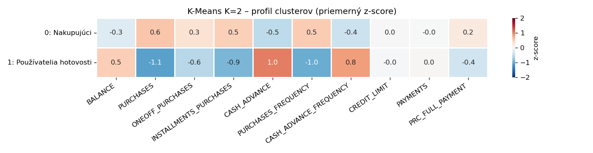

**K = 7**

| Cluster | Počet | Podiel | Názov | Popis |
|---|---|---|---|---|
| 0 | 291 | 3,3 % | Bez platieb (väčšinou neaktívni) | 239 z 291 má nulové platby; väčšina má minimálnu aktivitu (medián zostatku 32, nákupov 65), niektorí však majú výrazný dlh alebo výbery hotovosti (maximum zostatku 9 165, výberov 7 616) |
| 1 | 1 555 | 17,4 % | Drobní splátkoví nakupujúci | nízky limit, časté malé nákupy výhradne na splátky |
| 2 | 1 402 | 15,7 % | Revolveri | najvyšší dlh, nákupy aj výbery hotovosti, nesplácajú celú sumu |
| 3 | 2 070 | 23,1 % | Hotovostní dlžníci | žiadne nákupy, iba výbery hotovosti |
| 4 | 1 306 | 14,6 % | Heavy spenders | najvyššia útrata a frekvencia nákupov, vysoký limit |
| 5 | 1 258 | 14,1 % | Príležitostní nakupujúci | zriedkavé nákupy, bez splátok a hotovosti |
| 6 | 1 068 | 11,9 % | Transactors / rich savers | pravidelné nákupy, splácajú celú sumu, takmer bez dlhu |

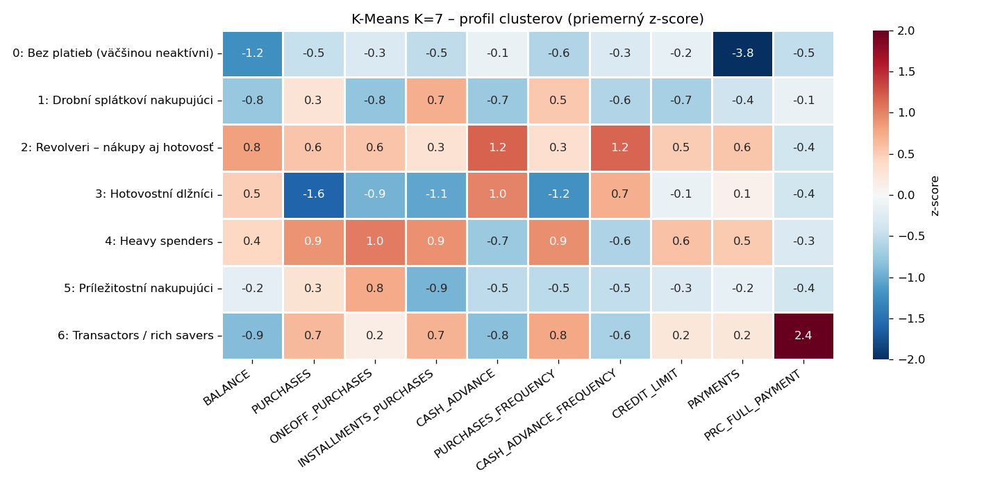
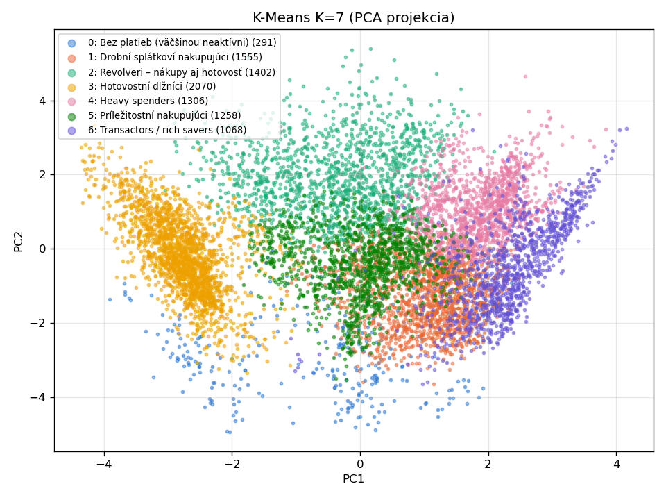

**Vzťah K = 2 a K = 7**

| K=2 \ K=7 | Drobní splátkoví | Heavy spenders | Hotovostní dlžníci | Bez platieb | Príležitostní | Revolveri | Transactors |
|---|---|---|---|---|---|---|---|
| Nakupujúci | 1 538 | 1 306 | 0 | 177 | 1 027 | 816 | 1 060 |
| Používatelia hotovosti | 17 | 0 | 2 070 | 114 | 231 | 586 | 8 |

Hotovostní dlžníci pochádzajú výhradne z clustera „Používatelia hotovosti“; heavy spenders,
transactors a drobní splátkoví nakupujúci z clustera „Nakupujúci“. Revolveri, ktorí nakupujú
aj vyberajú hotovosť, ležia na hranici a K=2 ich rozdelí približne napoly. Ilustruje to
vlastnosť K-Means: každý bod musí byť priradený do niektorého clustera, aj keď leží medzi nimi.

### 5. DBSCAN

DBSCAN s Euklidovskou vzdialenosťou. Parametre:
- **MinPts = 2 × dimenzia = 20**,
- **Eps ≈ 2,28**: lakeť k-distance grafu (vzdialenosť k 20. najbližšiemu susedovi),
  nájdený automaticky metódou Kneedle (knižnica `kneed`).

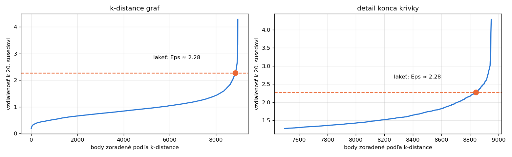

**Výsledok: 1 cluster (8 935 používateľov) a 15 bodov šumu.**

Používatelia teda netvoria hustotne oddelené skupiny, ale jedno spojité zoskupenie s plynulými
prechodmi medzi typmi správania. Zodpovedá to nízkej silhouette (≈ 0,25) pri K-Means: K-Means
toto zoskupenie rozdelí na zadaný počet častí, DBSCAN v ňom nenájde riedku oblasť, ktorá by ho
rozdelila.

Šum (15 používateľov) tvoria dva typy extrémov:

- **Aktívni, ale nesplácajúci (10)**: majú zostatok, nakupujú alebo vyberajú hotovosť, ale
  `PAYMENTS = 0`. Z pohľadu banky ide o najrizikovejších klientov.
- **Nezvyčajné kombinácie a nekonzistentné dáta (5)**: napr. používateľ s kreditným limitom 50
  a výbermi hotovosti 5 677 (C17140), alebo používateľ, ktorého nákupy na splátky prevyšujú
  celkové nákupy (C11506). Ide pravdepodobne o chyby v dátach.

Identifikácia týchto extrémov je výhodou DBSCAN oproti K-Means, ktorý musí každého používateľa
priradiť do niektorého clustera.

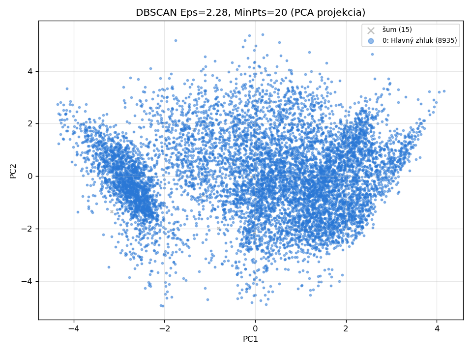

#### Citlivosť na Eps

Lakeť k-distance grafu je heuristika. Pri Eps ≈ 2,28 sa husté oblasti pospájajú do jedného
clustera, preto sme pri MinPts = 20 vyskúšali menšie hodnoty Eps:

| Eps | clusterov | šum | silueta (bez šumu) | veľkosti clusterov |
|---|---|---|---|---|
| 0,8 | 7 | 39,6 % | 0,266 | 1735, 1344, 1275, 605, 243, 172, 32 |
| 0,9 | 7 | 27,6 % | 0,169 | 3036, 1809, 711, 436, 357, 114, 14 |
| **1,0** | **6** | **17,0 %** | **0,155** | **4794, 1855, 698, 30, 25, 24** |
| 1,1 | 5 | 11,6 % | 0,184 | 5908, 1875, 64, 42, 22 |
| 1,2 | 3 | 7,3 % | 0,254 | 8218, 52, 29 |
| 1,4 | 4 | 3,6 % | 0,233 | 8490, 60, 56, 22 |
| 1,6 | 3 | 1,9 % | 0,253 | 8607, 99, 70 |
| 1,8 | 1 | 1,3 % | – | 8838 |
| 2,0 | 1 | 0,5 % | – | 8906 |


Bolo zvolené **Eps = 1,0** ako kompromis medzi počtom clusterov a podielom šumu:
pri menšom Eps je ako šum označených 28–40 % používateľov, pri Eps ≥ 1,2 patrí viac než 90 %
používateľov do jedného clustera. Eps = 1,1 má síce menej šumu (11,6 %) a vyššiu siluetu, ale
revolveri (698) sa zlejú s bežnými nakupujúcimi a obe skupiny plne splácajúcich sa spoja do jednej,
čím sa stratia segmenty, ktoré chceme rozlíšiť.

Silueta nebola pri DBSCAN použitá ako kritérium výberu, pretože:
- predpokladá kompaktné clustery okolo stredu, kým DBSCAN nachádza clustery ľubovoľného tvaru
  (napr. pretiahnutý cluster „Bežní nakupujúci“ silueta penalizuje, hoci je hustotne korektný),
- počíta sa bez bodov šumu, takže zvýhodňuje malé Eps, pri ktorých sa vynechá veľká časť dát
  (pri Eps = 0,8 je silueta najvyššia, ale ignoruje 40 % používateľov).

**Clustery pri Eps = 1,0, MinPts = 20**

| Cluster | Počet | Podiel | Názov | Popis |
|---|---|---|---|---|
| 0 | 4 794 | 53,6 % | Bežní nakupujúci | pravidelné nákupy, bez výberov hotovosti |
| 1 | 1 855 | 20,7 % | Hotovostní dlžníci | žiadne nákupy, iba výbery hotovosti |
| 2 | 698 | 7,8 % | Revolveri | vysoký dlh, časté nákupy aj výbery hotovosti |
| 3 | 30 | 0,3 % | Hotovosť bez splácania | výbery hotovosti (medián 1 640), nulové platby, ale nízky zostatok (medián 158), čo je pravdepodobne nezrovnalosť v dátach |
| 4 | 25 | 0,3 % | VIP | limit 9 000, veľké nákupy, splácajú 100 % („rich savers“) |
| 5 | 24 | 0,3 % | Menšie nákupy, plne splácajú | vysoký limit, menšie nákupy, splácajú 100 % |
| −1 | 1 524 | 17,0 % | šum | používatelia v riedkych prechodových oblastiach, zmiešané správanie |

Veľké clustery (hotovostní dlžníci, revolveri) zodpovedajú K-Means, čo potvrdzuje ich
robustnosť. DBSCAN navyše našiel malé, veľmi homogénne skupiny (VIP, hotovosť bez splácania),
ktoré K-Means rozpúšťa vo väčších clusteroch.

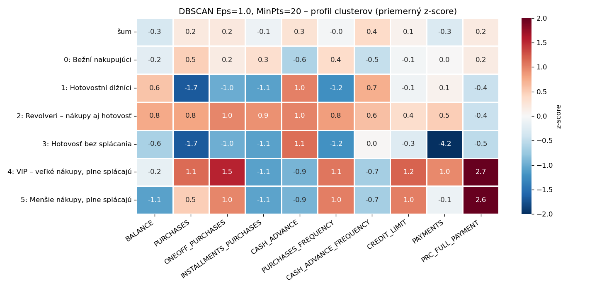
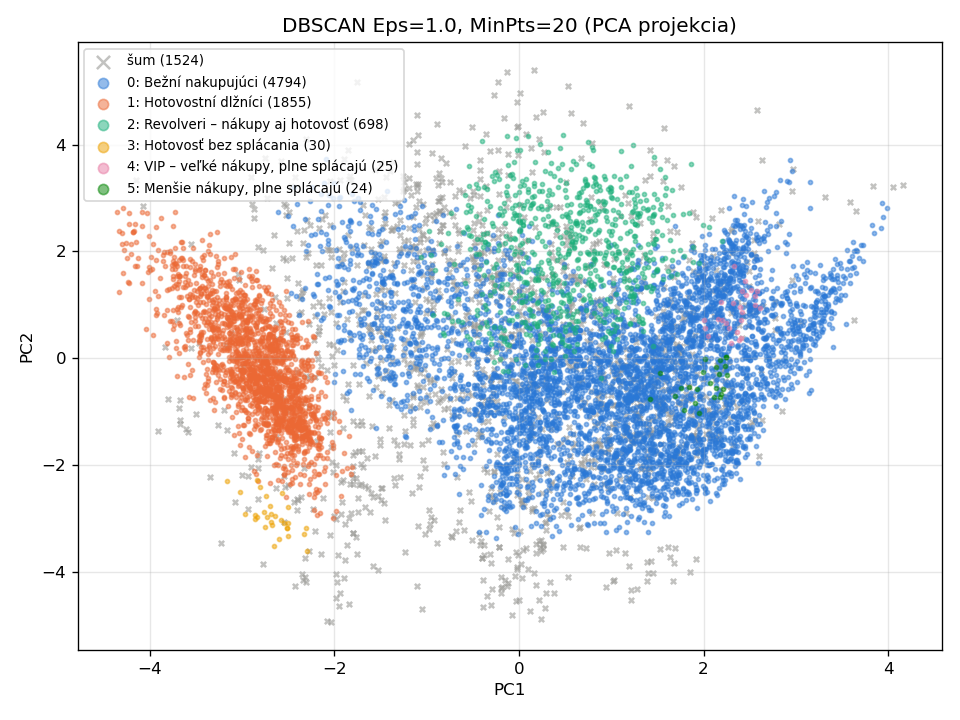

### 6. Bonus: Hierarchický clustering

Aglomeratívny clustering s Euklidovskou vzdialenosťou (`scipy.cluster.hierarchy.linkage`).

#### Centroid linkage (vzdialenosť centier clusterov)

| K | silueta | veľkosti clusterov |
|---|---|---|
| 2 | 0,381 | 8 949, 1 |
| 3 | 0,347 | 8 948, 1, 1 |
| 6 | 0,134 | 8 698, 247, 2, 1, 1, 1 |
| 10 | 0,136 | 6 435, 1 986, 273, 243, 4, 4, 2, 1, 1, 1 |

Centroid linkage na týchto dátach degeneruje: vznikne jeden obrí cluster a ostatné clustery
tvoria jednotlivé extrémne body. Centroid veľkého clustera sa pri pripojení ďalšieho bodu takmer
nepohne, preto sa izolované extrémy pripoja až v posledných krokoch. Metóda tak funguje skôr ako
detektor outlierov a oddelené body sa čiastočne zhodujú so šumom DBSCAN pri Eps ≈ 2,28: pri K = 6
sú to 2 z 5 bodov v najmenších clusteroch (C17140, C11067).

Centroid linkage navyše nie je monotónna: vzdialenosť pri spojení môže oproti predchádzajúcemu
spojeniu klesnúť (794 takýchto inverzií, viditeľné aj v dendrograme). Rez stromom preto nemusí dať
presne požadovaný počet clusterov, napr. pri K = 9 vznikne len 8 clusterov.

Skupina 247 používateľov zodpovedá takmer presne všetkým 240 používateľom s `PAYMENTS = 0`.
Rovnakú skupinu nájdu aj K-Means (cluster „Bez platieb“) a Ward. Nulové platby sú po
transformácii `log(1 + x)` výrazne vzdialené od ostatných hodnôt, preto túto skupinu oddelia
všetky metódy.

Silueta pri K = 2 (0,38) je vyššia než pri K-Means, ale rozdelenie 8 949 : 1 nemá
pre segmentáciu žiadnu hodnotu. Vysoká silueta teda sama osebe neznamená užitočné clustery.

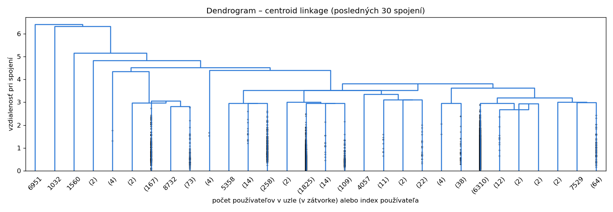

#### Wardova metóda

Ward spája clustery, ktorých spojenie najmenej zvýši súčet štvorcov vzdialeností od centra:
`Δ(A, B) = n_A·n_B / (n_A + n_B) · ‖c_A − c_B‖²`. Ide teda tiež o Euklidovskú vzdialenosť centier,
váženú veľkosťou clusterov, čo zabraňuje degenerácii.

| K | 2 | 3 | 4 | 5 | 6 | 7 | 8 | 9 | 10 |
|---|---|---|---|---|---|---|---|---|---|
| silueta | **0,256** | 0,213 | 0,233 | 0,226 | *0,239* | 0,215 | 0,220 | 0,210 | 0,189 |

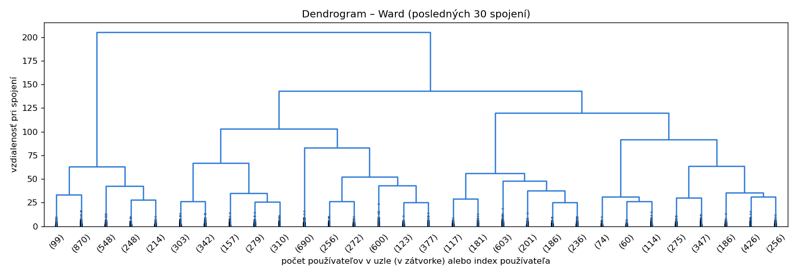
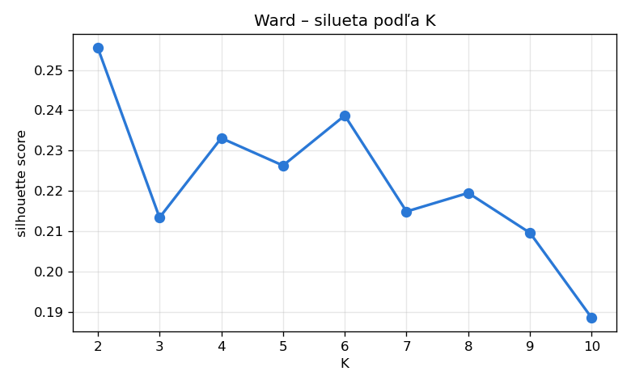

Pre K = 6 (lokálne maximum siluety):

| Cluster | Počet | Podiel | Názov | Popis |
|---|---|---|---|---|
| 0 | 1 979 | 22,1 % | Hotovostní dlžníci | žiadne nákupy, iba výbery hotovosti |
| 1 | 1 391 | 15,5 % | Transactors / rich savers | pravidelné nákupy, splácajú takmer celú sumu |
| 2 | 2 318 | 25,9 % | Pravidelní nakupujúci | časté nákupy, hlavne na splátky |
| 3 | 1 524 | 17,0 % | Revolveri | najvyšší dlh, nákupy aj výbery hotovosti |
| 4 | 248 | 2,8 % | Bez platieb (väčšinou neaktívni) | nulové platby, väčšinou minimálna aktivita |
| 5 | 1 490 | 16,6 % | Príležitostní nakupujúci | zriedkavé jednorazové nákupy |

Zhoda s K-Means K = 7: **Adjusted Rand Index = 0,616** (1 = identické rozdelenie,
0 = zhoda ako pri náhode). Ward našiel rovnaké segmenty, len spojil „drobných splátkových
nakupujúcich“ a „heavy spenders“ do jedného clustera.

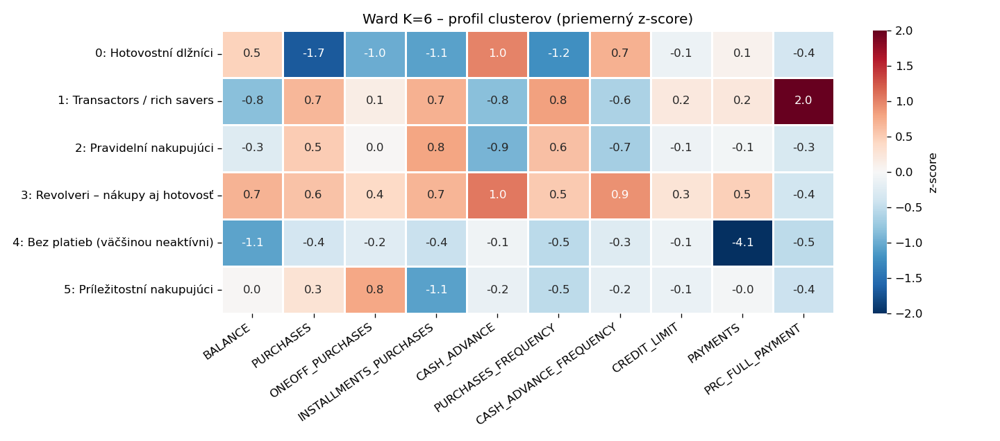
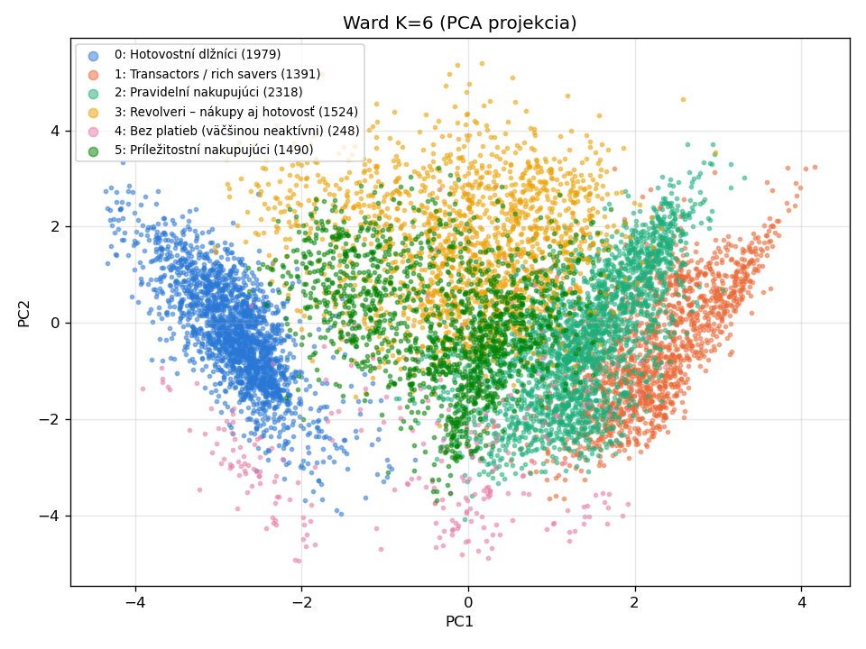