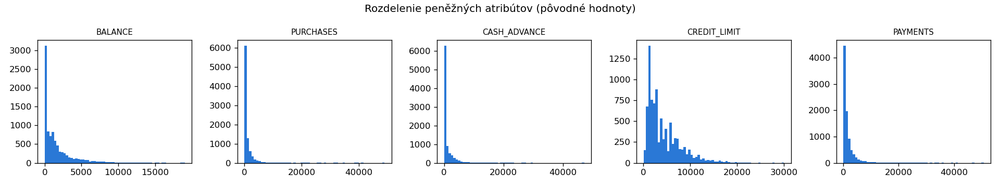
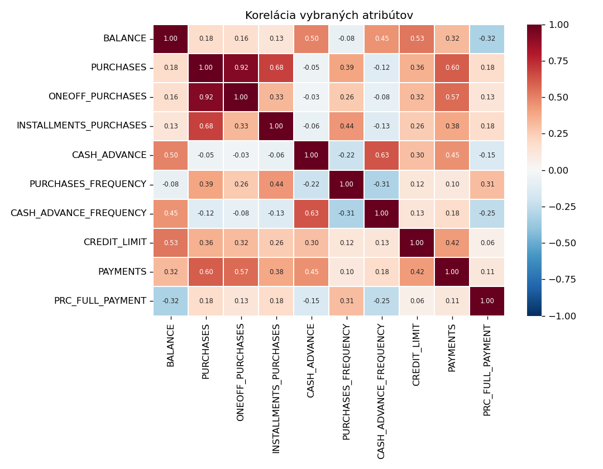
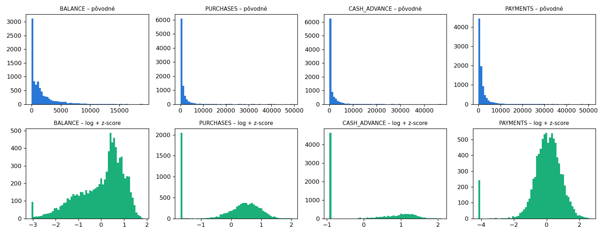
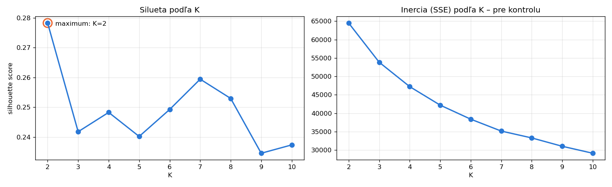
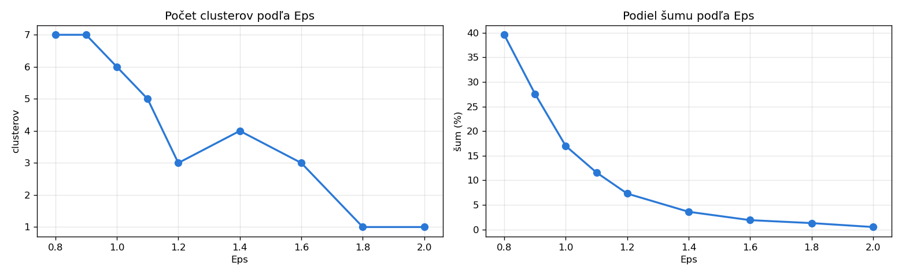

# Clustering používateľov kreditných kariet

Segmentácia používateľov kreditných kariet pomocou algoritmov **K-Means**, **DBSCAN** a (bonus)
**aglomeratívneho hierarchického clusteringu**. Cieľom je nájsť skupiny používateľov s podobným
správaním, charakterizovať ich a pomenovať (napr. „heavy spenders“, „rich savers“).

## Dataset

`data/cc_general.csv` obsahuje 8 950 používateľov a 18 atribútov popisujúcich používanie kreditnej
karty (zostatok, nákupy, výbery hotovosti, platby, kreditný limit, …). Popis atribútov je
v `data/dataset-vysvetlivky.xlsx`.

## Štruktúra projektu

```
├── data/              # dataset a vysvetlivky
├── figures/           # vygenerované grafy
├── src/
│   ├── config.py      # cesty a konštanty
│   └── data.py        # načítanie dát a prieskumná analýza
├── main.py            # vstupný bod
└── requirements.txt
```

## Spustenie

```bash
python -m venv .venv
source .venv/bin/activate        # Windows: .venv\Scripts\activate
pip install -r requirements.txt
python main.py
```

## Postup

### 1. Prieskum dát

- 8 950 používateľov, 18 atribútov; `CUST_ID` je iba identifikátor a pre clustering sa nepoužije.
- Chýbajúce hodnoty: `MINIMUM_PAYMENTS` (313×), `CREDIT_LIMIT` (1×).
- Peňažné atribúty sú silne pravostranne zošikmené (napr. `PURCHASES`: medián ~361, maximum ~49 000).
  Keďže oba algoritmy používajú Euklidovskú vzdialenosť, je nutná transformácia a škálovanie.
- `CASH_ADVANCE_FREQUENCY` má maximum 1,5, hoci ide o frekvenciu v rozsahu 0–1, čo je chyba v dátach.



### 2. Výber atribútov a predspracovanie

Pre clustering sme ponechali 10 atribútov: `BALANCE`, `PURCHASES`, `ONEOFF_PURCHASES`,
`INSTALLMENTS_PURCHASES`, `CASH_ADVANCE`, `PURCHASES_FREQUENCY`, `CASH_ADVANCE_FREQUENCY`,
`CREDIT_LIMIT`, `PAYMENTS`, `PRC_FULL_PAYMENT`. Vyradené boli identifikátor, redundantné atribúty
(počty transakcií, čiastkové frekvencie), takmer konštantné atribúty (`TENURE`, `BALANCE_FREQUENCY`)
a `MINIMUM_PAYMENTS` (chýbajúce hodnoty).

Predspracovanie:
1. chýbajúci `CREDIT_LIMIT` doplnený mediánom,
2. `CASH_ADVANCE_FREQUENCY` orezaná na maximum 1,
3. peňažné atribúty transformované `log(1 + x)` kvôli zošikmenosti,
4. štandardizácia (z-score), aby mali všetky atribúty v Euklidovskej vzdialenosti rovnakú váhu.




### 3. K-Means

K-Means s Euklidovskou vzdialenosťou (`n_init=10`, `random_state=42`). Počet clusterov K bol
zvolený podľa silhouette score pre K = 2–10:

| K | 2 | 3 | 4 | 5 | 6 | 7 | 8 | 9 | 10 |
|---|---|---|---|---|---|---|---|---|---|
| silueta | **0,278** | 0,242 | 0,248 | 0,240 | 0,249 | *0,259* | 0,253 | 0,235 | 0,237 |

- Maximum siluety je pri **K = 2** (0,278). Vzniknú clustery s 5 924 a 3 026 používateľmi.
- Lokálne maximum je pri **K = 7** (0,259). Toto rozdelenie použijeme pre jemnejšiu segmentáciu.
- Nízke hodnoty siluety (≈ 0,25) naznačujú, že dáta netvoria ostro oddelené zhluky, ale skôr
  spojité kontinuum používateľov s plynulými prechodmi.




**Vzťah K = 2 a K = 7**

| K=2 \ K=7 | Drobní splátkoví | Heavy spenders | Hotovostní dlžníci | Neaktívni | Príležitostní | Revolveri | Transactors |
|---|---|---|---|---|---|---|---|
| Nakupujúci | 1 538 | 1 306 | 0 | 177 | 1 027 | 816 | 1 060 |
| Používatelia hotovosti | 17 | 0 | 2 070 | 114 | 231 | 586 | 8 |

Hotovostní dlžníci pochádzajú výhradne z clustera „Používatelia hotovosti“; heavy spenders,
transactors a drobní splátkoví nakupujúci z clustera „Nakupujúci“. Revolveri, ktorí nakupujú
aj vyberajú hotovosť, ležia na hranici a K=2 ich rozdelí približne napoly. Ilustruje to
vlastnosť K-Means: každý bod musí byť priradený do niektorého clustera, aj keď leží medzi nimi.

Šum (15 používateľov) tvoria dva typy extrémov:

- **Aktívni, ale nesplácajúci (10)**: majú zostatok, nakupujú alebo vyberajú hotovosť, ale
  `PAYMENTS = 0`. Nulové platby majú inak iba neaktívni používatelia, preto je táto kombinácia
  vzácna. Z pohľadu banky ide o najrizikovejších klientov.
- **Nezvyčajné kombinácie a nekonzistentné dáta (5)**: napr. používateľ s kreditným limitom 50
  a výbermi hotovosti 5 677 (C17140), alebo používateľ, ktorého nákupy na splátky prevyšujú
  celkové nákupy (C11506). Ide pravdepodobne o chyby v dátach.

Identifikácia týchto extrémov je výhodou DBSCAN oproti K-Means, ktorý musí každého používateľa
priradiť do niektorého clustera.


#### Citlivosť na Eps

Lakeť k-distance grafu je heuristika. Pri Eps ≈ 2,28 sa husté oblasti pospájajú do jedného
clustera, preto sme pri MinPts = 20 vyskúšali menšie hodnoty Eps:

| Eps | clusterov | šum | silueta (bez šumu) | veľkosti clusterov |
|---|---|---|---|---|
| 0,8 | 7 | 39,6 % | 0,266 | 1735, 1344, 1275, 605, 243, 172, 32 |
| 0,9 | 7 | 27,6 % | 0,169 | 3036, 1809, 711, 436, 357, 114, 14 |
| **1,0** | **6** | **17,0 %** | **0,155** | **4794, 1855, 698, 30, 25, 24** |
| 1,1 | 5 | 11,6 % | 0,184 | 5908, 1875, 64, 42, 22 |
| 1,2 | 3 | 7,3 % | 0,254 | 8218, 52, 29 |
| 1,4 | 4 | 3,6 % | 0,233 | 8490, 60, 56, 22 |
| 1,6 | 3 | 1,9 % | 0,253 | 8607, 99, 70 |
| 1,8 | 1 | 1,3 % | – | 8838 |
| 2,0 | 1 | 0,5 % | – | 8906 |



Bolo zvolené **Eps = 1,0** ako kompromis medzi počtom clusterov a podielom šumu:
pri menšom Eps je ako šum označených 28–40 % používateľov, pri Eps ≥ 1,2 patrí viac než 90 %
používateľov do jedného clustera.

Silueta nebola pri DBSCAN použitá ako kritérium výberu, pretože:
- predpokladá kompaktné clustery okolo stredu, kým DBSCAN nachádza clustery ľubovoľného tvaru
  (napr. pretiahnutý cluster „Bežní nakupujúci“ silueta penalizuje, hoci je hustotne korektný),
- počíta sa bez bodov šumu, takže zvýhodňuje malé Eps, pri ktorých sa vynechá veľká časť dát
  (pri Eps = 0,8 je silueta najvyššia, ale ignoruje 40 % používateľov).